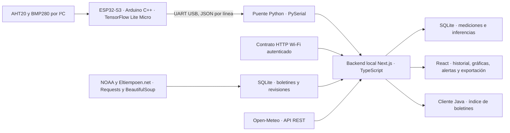

# AgroEdge IA

AgroEdge IA es una estación de monitoreo agroclimático con inferencia local para Toca, Boyacá. La ESP32-S3 mide temperatura, humedad relativa y presión atmosférica, clasifica perfiles de exposición de **invernadero** y **exterior**, y envía las lecturas a un panel web local. El panel permite comparar las condiciones medidas con pronósticos y boletines que conservan su procedencia y fecha.

## Problema y objetivos

Las condiciones bajo cubierta y al aire libre pueden diferir del pronóstico municipal. El proyecto busca hacer visibles esas diferencias mediante una estación accesible y trazabilidad de las lecturas. Su aporte para el trabajo agrícola es contextualizar el ambiente observado y revisar cambios de exposición junto al pronóstico. Las salidas se interpretan con observación de campo y criterio agronómico. La caracterización y las encuestas del equipo se incorporan por separado al documento académico.

- Registrar variables ambientales con trazabilidad desde la estación hasta la exportación.
- Ejecutar un modelo int8 sobre la ESP32-S3 y verificar su concordancia con TensorFlow Lite en el PC.
- Integrar el pronóstico municipal, el historial de la estación y el contexto ENSO mediante fuentes identificables.

## Arquitectura y tecnologías



La aplicación presenta gráficas, filtros por estación, sesión y fecha, exportación CSV/XLSX y alertas de calidad. El detector adaptativo marca desviaciones estadísticas después de validar las muestras. El origen y el tipo de dato distinguen lecturas reales, simulación y pruebas de transporte. La integración física del modelo se comprobó mediante **USB**. El contrato Wi-Fi se verificó por HTTP con fixtures de simulación.

| Componente | Estructura y uso |
| --- | --- |
| Firmware | Ventana circular de seis muestras y sumas incrementales. La inserción y la obtención de características cuestan O(1), y el almacenamiento escala con el tamaño de la ventana. |
| SQLite | Claves únicas para la identidad de medición y las revisiones, índices B-tree para consultas por origen y tiempo, y transacciones para reservar las actualizaciones. |
| Java | `HashMap` por revisión para acceso promedio O(1) y `TreeMap` por fecha para intervalos en O(log D + K), con D fechas y K resultados. |

[Arquitectura y contratos](docs/integracion.md) · [Detector adaptativo](docs/detector-regimen.md) · [Índice Java](java/r5/src/BulletinIndex.java)

## Instalación local

Usa Node.js **24.14.0 o posterior dentro del rango declarado en `package.json`**, npm y Python 3 para el puente y los scrapers. La distribución se verificó con Node.js 24.14.0, npm 11.9.0 y Python 3.14.3. Java 17 con Gson 2.15.0 es necesario para el cliente de boletines. El firmware requiere Arduino CLI y ESP32 by Espressif Systems 4.0.0. La guía del sketch fija el resto de dependencias y el perfil probado.

Desde la raíz del código, en PowerShell:

```powershell
npm.cmd ci
py -m venv .venv-entrega
$python = (Resolve-Path .venv-entrega/Scripts/python.exe).Path
& $python -m pip install -r hardware/requirements.txt -r scraper/requirements.txt
$env:AGROEDGE_PYTHON = $python
npm.cmd run dev
```

Abre `http://127.0.0.1:5173`. La plataforma crea la SQLite de mediciones en `data/`. La configuración de ejemplo en [`.env.example`](.env.example) identifica las rutas opcionales y las variables del sistema. Configura un token propio únicamente si usas ingreso HTTP autenticado desde otro cliente.

## Conexiones y adquisición USB

```text
ESP32-S3 3V3   ── VCC  AHT20     ── VCC  BMP280
ESP32-S3 GND   ── GND  AHT20     ── GND  BMP280
ESP32-S3 GPIO8 ── SDA  AHT20     ── SDA  BMP280
ESP32-S3 GPIO9 ── SCL  AHT20     ── SCL  BMP280
PC             ── USB-UART      ── ESP32-S3
```

El perfil probado usa el AHT20 con dirección `0x38` y el BMP280 con `0x77`, ambos a 3,3 V. La conexión serial es **115200 baudios, 8N1**, con un objeto JSON UTF-8 por línea. En el dashboard selecciona **Adquisición por USB**, abre **Conexión**, elige el puerto que enumere Windows y conecta. El ensayo de referencia usó COM8, y el número puede cambiar entre equipos. Con USB sin reloj propio, `RECEIPT` identifica la hora de recepción como fuente temporal. Cada arranque identifica una sesión nueva.

Al arrancar, el clasificador reúne seis muestras. Comprueba en **Clasificación TinyML** la versión `exposure-tflm-2c4870d61d3f`. La salida es un perfil de exposición y su puntuación es el margen cuantizado al umbral. La guía del firmware incluye dependencias, FQBN, perfil de Flash y PSRAM, y los pasos para compilar una placa de ensayo. [Firmware definitivo](hardware/esp32_tinyml/README.md)

## Fuentes meteorológicas

| Fuente | Acceso y resultado en AgroEdge IA |
| --- | --- |
| **NOAA CPC** | Requests y BeautifulSoup extraen el título, la sinopsis y el estado ENSO del boletín HTML. SQLite guarda las ediciones y deduplica por huella. La ejecución diaria verificada quedó a las 16:30 de Bogotá. |
| **Eltiempoen.net** | Requests obtiene el HTML de Toca. BeautifulSoup verifica la URL canónica y la atribución, y lee las tablas con `table.tabla--calor`, `thead th` y `tbody tr`. SQLite conserva revisión, hora, método y huella. La tarea de Windows quedó a las 09:00, con seis horas de intervalo interno y respeto de `robots.txt` y `Retry-After`. La actualización HTTPS del 24 de noviembre almacenó 48 horas y el panel mostró 27 vigentes durante la comprobación. |
| **Open-Meteo** | La plataforma consulta la **API REST** para el pronóstico horario y los acumulados de precipitación en horizontes de 24 y 48 horas. La ubicación y la hora se muestran como información meteorológica externa. |

El contexto externo permanece separado de las etiquetas utilizadas para entrenar el modelo. La carpeta `evidencias/meteorologia/Bases_de_consulta`, incluida en el ZIP de código, conserva las SQLite meteorológicas verificadas. Para inspeccionarlas localmente sin iniciar recolectores, apunta `AGROEDGE_R5_DIR` a esa carpeta antes de iniciar la plataforma. La pestaña de pronóstico también puede consultar Open-Meteo a través de su API si hay red. [Evidencias y procedencia](evidencias/README.md) · [NOAA CPC](https://www.cpc.ncep.noaa.gov/products/analysis_monitoring/enso_advisory/ensodisc_Sp.shtml) · [Eltiempoen.net](https://eltiempoen.net/colombia/el-tiempo-en-toca) · [Open-Meteo](https://open-meteo.com/en/docs)

## Resultados experimentales

| Indicador | Resultado verificado |
| --- | --- |
| Captura y particiones | 2.823 lecturas auditadas en 6 sesiones. 183 ventanas de seis lecturas, con 59 de entrenamiento, 61 de validación y 63 de prueba. |
| Modelo final | Regresión lineal regularizada, exportada a TensorFlow Lite int8 con un operador `FULLY_CONNECTED`, 1.160 bytes. |
| Resultado de campo | 76,7 % de exactitud balanceada en validación y 63 de 63 clasificaciones correctas en las dos sesiones de prueba. Se saturaron 43 componentes de humedad en prueba. La evaluación cubre una estación y las condiciones observadas. |
| Inferencia física | Paridad de clase y salida cuantizada en los 63 vectores, y seis clasificaciones consecutivas recibidas por AgroEdge IA vía USB. |
| Banco aislado | 256 inferencias tras 16 de calentamiento. Media de 8,674 µs y 2.081,676 ciclos a 240 MHz. Imagen de aplicación de 401.088 B, RAM estática de 28.952 B y arena usada de 532 B. |
| Energía | Estimación para el chip de 1,886 a 3,088 µJ por inferencia según escenario, calculada con la latencia del banco y corrientes de referencia de Espressif. La medición eléctrica directa de la placa queda pendiente. |

La latencia del panel corresponde a la ejecución en una ventana de lecturas reales y su cálculo de puntuación. La del banco usa vectores preparados y un contador de ciclos. [Cierre técnico y limitaciones](docs/cierre-tecnico-2026-11-24.md) · [Matriz R1–R8](MATRIZ_DE_REQUISITOS.md)

## Verificación y organización

Ejecuta las comprobaciones en una extracción independiente con las dependencias instaladas. Los extractores se prueban desde archivos HTML y respuestas controladas. El banco físico archivado permite evaluar los recursos del modelo sin acceder al dispositivo.

```powershell
& $python -B -m unittest discover -s tests
npm.cmd test
npm.cmd run check
npm.cmd run build
npm.cmd run test:app
```

| Ruta | Contenido |
| --- | --- |
| `app/`, `components/`, `lib/` | API, interfaz, validación, persistencia y pronóstico. |
| `hardware/esp32_tinyml/` | Sketch definitivo, modelo congelado, perfil y guía de compilación. |
| `hardware/bridge.py`, `scraper/`, `scripts/` | Puente USB, recolectores, trazabilidad y reproducción de resultados. |
| `java/r5/`, `tests/` | Cliente Java, índices y pruebas de regresión. |
| `examples/` | Fixtures de transporte y referencias experimentales, incluido el prototipo de centroides. |
| `docs/`, `evidencias/` | Índice técnico, auditoría, datos y pruebas de campo entregadas con la distribución. |

[Índice técnico](docs/INDICE_TECNICO.md) · [Evidencias de la distribución](evidencias/README.md) · [Licencias y atribuciones](docs/ATRIBUCIONES.md)

## Equipo y contribuciones registradas

El equipo está integrado por **Juan Alejandro Castillo Arévalo** y **Sergio Andrés Guerrero Alba**. La bitácora de entrenamiento identifica a Juan como responsable de esa adquisición. Los registros de validación y prueba identifican a Sergio como observador de los intervalos de exposición confirmados. El historial de Git se adjunta tal como está registrado y las bitácoras documentan el trabajo de campo. [Bitácoras y evidencias de la campaña](evidencias/README.md)
